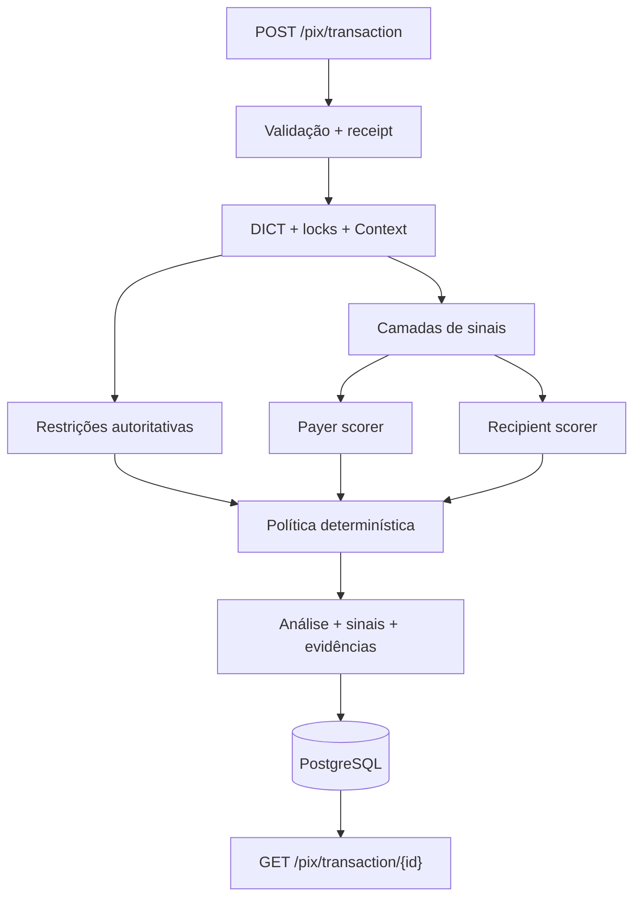

# [Nome do grupo]

**Integrantes:** [nomes]

## Como o motor de decisão funciona

O serviço recebe um Pix, valida o contrato, consulta o estado autoritativo e o histórico, avalia evidências do DICT e produz uma decisão determinística antes da autorização: `approved`, `two_factor_required` ou `rejected`.

O controller coordena receipt/idempotência, locks, histórico e persistência. O pacote `antifraud` recebe um `Context` pronto e devolve sinais, scores separados para pagador e recebedor e a regra que decidiu. O resultado completo fica gravado e pode ser consultado pelo `GET`.



As restrições são vetos explícitos e vêm antes dos scores. Os scorers são lógicos: o código compartilha o agregador, mas mantém os eixos separados. O DICT é uma fonte de evidência, não uma probabilidade de fraude. `unavailable` não significa segurança.

## Regras

As regras são sinais independentes. Cada uma produz `triggered`, `not_triggered` ou `unavailable`, com evidência e pontos. Os pontos acumulam em famílias com teto; depois são agregados nos scores do pagador e do recebedor. Pesos e limiares estão em [`policy.py`](bootcamp-base-api/src/antifraud/policy.py).

| Regra | Lógica | Parâmetros | Por quê |
|---|---|---|---|
| P01 | conta pagadora recém-aberta | < 7 dias, +10 | conta nova pode ser laranja, mas não prova fraude |
| L01 | valor alto no período noturno | 20h–6h e > R$ 1.000, +8 | sequestro/acesso fora do padrão; sinal fraco |
| R01 | conta destino recém-aberta | < 7 dias, +12 | risco de conta laranja recém-criada |
| REL03 | mesmo titular | documentos iguais, -5 | autotransferência é comum |
| L02 | valor alto em device não confiável | > R$ 200 ou > R$ 1.000 no dia, +10 | operação em aparelho sem vínculo autoritativo |
| G01 | localização distante do padrão | > 300 km com histórico suficiente, +6 | ajuda a detectar tomada de conta, sem bloquear sozinha |
| P03 | device não confiável | sem vínculo ativo, +18 | aparelho não cadastrado aumenta risco de ATO |
| P04 | muitas tentativas | ≥ 5 em 5 min, +20 | rajada de transferências |
| P05 | montante alto | > R$ 8.000 em 1 h, +15 | fracionamento/saída rápida de dinheiro |
| P06 | valor atípico | > 5× mediana e ≥ R$ 1.000, +18 | valor muito acima do hábito aprovado |
| P07 | destinos inéditos | ≥ 3 em 10 min, +18 | vários recebedores novos sugerem drenagem |
| P08 | device compartilhado | ≥ 3 pagadores em 24 h, +12 | um aparelho operando várias contas |
| P09 | IP sem aprovação anterior | nenhum Pix aprovado no IP, +6 | rede nova é indício fraco |
| P10 | device e IP novos | P03 + P09, +12 | duas mudanças simultâneas são mais fortes |
| R02 | muitas entradas no destino | ≥ 5 Pix em 10 min, +16 | recebedor em rajada |
| R03 | muitos pagadores no destino | ≥ 4 documentos em 1 h, +20 | concentração de pagadores |
| R04 | conta nova concentrando pagadores | R01 + R03, +15 | combinação típica de conta laranja |
| REL01 | destino inédito | nenhum Pix aprovado no par, +8 | primeira relação exige mais contexto |
| REL02 | relação recorrente | ≥ 3 aprovados, primeiro ≥ 7 dias, -8 | hábito comprovado reduz fricção |
| DICT01 | estatística DICT desfavorável | nota < 30, +32 | evidência institucional adversa |
| DICT02 | marcação suspeita | fixture `suspicious`, +20 | evidência externa ainda não confirmada |
| DICT03 | marcação confirmada | fixture `confirmed_in_mock`, +25 | evidência externa mais forte |

Observação e aprovação não são a mesma coisa: qualquer tentativa conta para rajadas e volume; somente `approved` ensina device/IP, mediana, destinos conhecidos e relações. O cadastro autoritativo de devices é independente do histórico.

## Como as regras viram decisão

A política percorre a tabela na ordem abaixo; a primeira condição que casar vence:

| Ordem | Regra | Resultado |
|---:|---|---|
| 1 | `D-RESTRICT-SIM` | rejeita restrição autoritativa ativa |
| 2–5 | `D-REJ-ATO`, `D-REJ-PAY`, `D-REJ-RCP`, `D-REJ-CROSS` | rejeitam combinações fortes com evidência suficiente |
| 6–7 | `D-ATO-1`, `D-ATO-2` | pedem 2FA para possível tomada de conta |
| 8–9 | `D-PAY`, `D-RCP` | pedem 2FA quando um eixo chega a 40 |
| 10 | `D-OK` | aprova como fallback |

`approved` é um rótulo operacional, não uma confirmação posterior de legitimidade. Ainda não há retorno real de 2FA ou ground truth de fraude; por isso a política é determinística e auditável, não um modelo ML calibrado.

## Como rodar e testar

```bash
cd bootcamp-base-api
docker compose up -d --build --wait
until curl -sf http://localhost:1080/security-statistics/00000000000 >/dev/null; do sleep 1; done
```

Envie um Pix para `POST /pix/transaction` com `INTERNAL-TOKEN: default_token`. A resposta nova é `201`; o mesmo payload/idempotency key retorna `200`; o mesmo `id` com outro payload retorna `409`.

```bash
curl -s http://localhost:3000/pix/transaction/<id> \
  -H "INTERNAL-TOKEN: default_token"
```

O `GET` lê a análise persistida: `metadata.decision_rule`, `reasons`, `scores`, `signals`, `family_contributions`, `evidence_sufficiency` e `policy_version` tornam a decisão auditável.

Para a suíte de integração:

```bash
uv venv --python 3.11 .venv
uv pip install -r requirements-dev.txt
source .venv/bin/activate
APP_ENV=test docker compose up -d --build --force-recreate --wait
pytest
```

Os cenários estão organizados por contrato: aceitação (`test_cenarios_aceitacao.py`), decisões/rejeições (`test_decisoes.py`), fronteiras, contrato/idempotência, concorrência, histórico, DICT/geolocalização e resiliência/receipts. O relógio é fixável em `APP_ENV=test`, permitindo testar janelas sem depender da hora real.

## Documentação complementar

- [README interno completo](docs/README-interno.md): arquitetura detalhada, semântica dos relógios, receipts, indisponibilidade, modelagem do banco e limites de engenharia.
- [Guia para contribuidores](CONTRIBUTING.md): mapa do código e onde alterar cada responsabilidade.
- [README da API](bootcamp-base-api/README.md): configuração, rotas, mock do DICT e operação local.
- [Testes de integração](bootcamp-base-api/tests/integration/pix/README.md): catálogo dos cenários.

## Referência do desafio

- [`Desafio Antifraude Pix.pdf`](Desafio%20Antifraude%20Pix.pdf)
