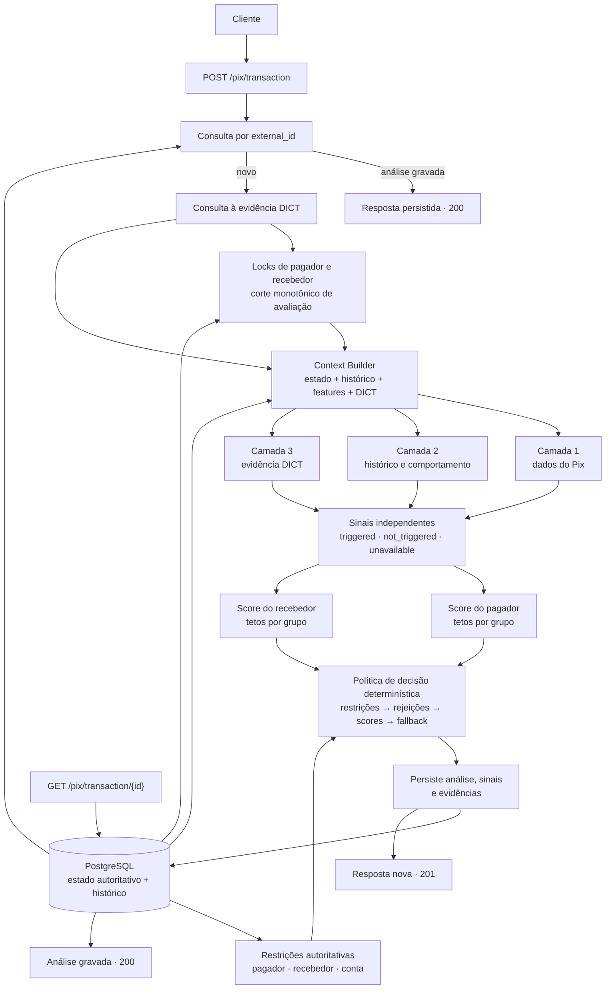
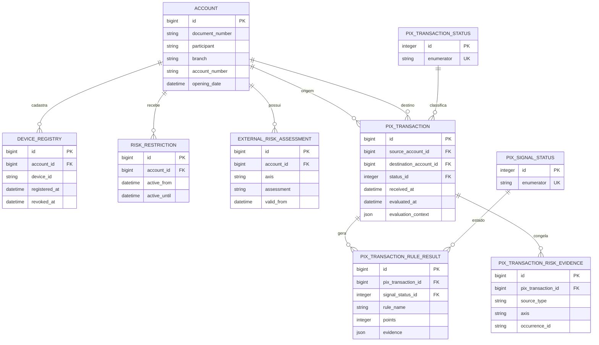

# [Nome do grupo — preencher]

**Integrantes:** [Integrantes — preencher]

## Como o motor de decisão funciona

> A modelagem consolidada está implementada na política determinística em [`policy.py`](../bootcamp-base-api/src/antifraud/policy.py), que é a referência operacional.

Uma API, feita a partir do Base Service ([`bootcamp-base-api/`](../bootcamp-base-api/)), que recebe um Pix em `POST /pix/transaction` e decide, antes de o dinheiro sair, entre `approved`, `two_factor_required` (pedir ao cliente uma segunda confirmação, o 2FA) e `rejected`; `GET /pix/transaction/{id}` devolve a análise gravada. Em volta do motor, o controller cuida do contrato, da idempotência, da consulta ao DICT (o diretório do Banco Central que liga chave Pix a conta), da trava e do histórico ([passo a passo](../bootcamp-base-api/README.md#6-o-caminho-de-uma-requisição)).

## Em 30 segundos

Este projeto é um motor antifraude síncrono para Pix. Ele recebe a transação, reúne o estado autoritativo e o histórico disponível, avalia sinais independentes e devolve uma decisão explicável antes da autorização do pagamento.

- **Entrada:** Pix, contas, dispositivo, IP, geolocalização opcional e evidências externas.
- **Processamento:** regras determinísticas, scores separados para pagador e recebedor, restrições prioritárias e fallback de 2FA quando falta evidência.
- **Saída:** status, regra que decidiu, scores, suficiência, sinais, evidências e versão da política — tudo persistido para consulta posterior.

O motor ([`src/antifraud/`](../bootcamp-base-api/src/antifraud/)) mora fora do controller, onde o Base Service põe a regra, para não se misturar com trava, sessão e commit ([o porquê](../bootcamp-base-api/docs/como-o-projeto-e-organizado.md#por-que-o-motor-é-um-pacote-à-parte)). É um pacote puro, determinístico, e roda três camadas em ordem, com o mesmo contrato — recebem o `Context` e devolvem seus sinais:



O fluxo acima é a visão para quem avalia o produto. O mapa de pastas, o contexto, as camadas, os scorers lógicos e o caminho linha a linha da requisição ficam no [guia para contribuidores](../CONTRIBUTING.md).

### As camadas do motor

1. **Validações iniciais** — o que o próprio Pix diz, sem histórico: conta nova, valor alto à noite, mesmo titular.
2. **Sinais e política** — regras determinísticas sobre o histórico, escritas à mão: sem fraude rotulada não há modelo a treinar, e cada resposta precisa caber numa frase.
3. **Evidência de segurança do DICT** — estatísticas e marcações simuladas do recebedor. O mock usa o campo `security_statistics`, separado das demais evidências.

Nenhuma camada lê o sinal de outra; quem junta é o engine, nos tetos, nas notas e na tabela de decisão. Cada sinal sai `triggered`, `not_triggered` ou `unavailable` (falta de histórico não vira ponto nem atestado); os pontos somam por grupo, com teto, em duas notas de 0 a 100 que não são probabilidade, **pagador** e **destino**, cada uma com a **suficiência das evidências**; e na **tabela de decisão** vale a primeira linha que casar. Tudo volta em `metadata` ([exemplo resolvido](#um-exemplo-resolvido)).

### Contrato do DICT nesta demonstração

O DICT é consultado como fonte de evidência de segurança, não como um número universal de confiança. `DICT01` representa estatística desfavorável; `DICT02` e `DICT03`, marcações suspeita e confirmada na fixture. `clear` significa apenas que nenhuma evidência adversa conhecida foi retornada; `unavailable` significa que a fonte não respondeu ou não permitiu concluir. Nenhum dos dois estados prova legitimidade ou fraude. O mock usa `/security-statistics/...` com o mesmo nome do campo conceitual.

## Infraestrutura da demonstração

O ambiente local tem três serviços Docker, com responsabilidades separadas:

| Serviço | Papel | Estado que mantém |
|---|---|---|
| `api` | expõe os endpoints Pix e executa o motor | nenhum estado local durável; usa banco e DICT |
| `db` | PostgreSQL autoritativo | contas, histórico Pix, sinais, evidências e análise |
| `dict-mock` | simula a fonte externa de evidência do DICT | expectativas HTTP seedadas para estatísticas e marcações |

O fluxo normal é síncrono: a API recebe o Pix, procura o `external_id` persistido, consulta o mock do DICT se for novo, adquire as travas necessárias, monta o contexto com o histórico, calcula a análise e persiste o resultado no PostgreSQL. O `GET` não reavalia o risco; ele lê a análise gravada.

O mock não é uma segunda API de negócio: ele existe apenas para tornar determinísticas as respostas da fonte externa. Em produção, essa fronteira seria substituída por um connector para o DICT real, sem mudar o contrato do motor.

## Conceitos de domínio que ficam escondidos no código

O motor não analisa apenas o JSON isolado. Ele cruza o Pix com algumas identidades e fontes de estado:

| Conceito | O que representa | Por que existe |
|---|---|---|
| **Account** | identidade account-scoped: documento + banco/agência/número | é a unidade usada pelo cadastro, restrições e avaliação; o histórico pode agregar linhas com o mesmo documento |
| **Device registry** | vínculo autoritativo entre pagador e `device_id`, com início e revogação | diz se o aparelho está cadastrado; não é inferido automaticamente porque um device apareceu em algum Pix |
| **DICT** | fonte externa sobre a chave/recebedor e evidências de segurança | adiciona evidência institucional ao eixo do recebedor; não substitui o histórico nem decide sozinho |
| **Risk restriction** | bloqueio explícito e temporal para pagador, recebedor ou conta | funciona como veto prioritário, antes dos scores |
| **External risk assessment** | marcação externa `clear`, `suspicious` ou `confirmed_in_mock` | representa inteligência adicional usada apenas quando a política exige evidência adversa |
| **Risk evidence snapshot** | cópia normalizada das fontes usadas naquela avaliação | permite explicar posteriormente quais evidências estavam disponíveis, mesmo se a fonte mudar |

### O que o DICT faz neste projeto

O DICT não é o motor antifraude e não produz uma “probabilidade de fraude”. Nesta demonstração, ele fornece duas classes de evidência para o recebedor:

- `DICT01`: estatística de segurança desfavorável, convertida em sinal com peso e teto próprios;
- `DICT02`/`DICT03`: marcações externas suspeita ou confirmada, usadas para reforçar rejeições demonstrativas.

Uma resposta `clear` significa apenas que aquela consulta não trouxe evidência adversa conhecida. Uma resposta `unavailable` significa que não foi possível consultar ou interpretar a fonte. O histórico local, as restrições e o DICT continuam sendo fontes diferentes, com semânticas diferentes.

### Por que o domínio é account-scoped

Não existe uma entidade `customer` separada. Uma linha de `account` carrega documento e dados bancários juntos; fontes autoritativas apontam para a conta e consultas de comportamento podem agregar linhas pelo documento quando a regra pede visão de titular. Isso mantém o esquema simples sem perder a semântica de documento.

## Restrições autoritativas

As restrições são uma fonte diferente dos sinais e dos scores. `risk_restriction` é uma blocklist operacional: uma instrução explícita de bloqueio para um pagador, titular recebedor ou conta recebedora. Ela não é inferida do histórico e não é apenas mais um sinal com pontos.

Cada registro guarda escopo, origem (`provenance`), identificador da ocorrência, início/fim de validade e estado revogado ou ativo. A consulta é temporal: restrição futura, expirada ou revogada não vale para o instante de avaliação.

Se uma restrição válida existe, `D-RESTRICT-SIM` rejeita o Pix mesmo que os sinais estejam baixos ou alguma fonte de risco esteja indisponível. Se a fonte de restrições estiver indisponível, o sistema não aprova silenciosamente: a avaliação falha sem gravar uma análise, porque não é seguro afirmar que não existe um veto.

Essa separação evita transformar um cadastro operacional em mais alguns pontos heurísticos: restrição é veto; histórico e DICT são evidências graduais.

## Idempotência do POST

O serviço assume processamento síncrono, sem fila e sem estado persistido de `processing` ou `failed`. A idempotência é resolvida diretamente em `pix_transaction`: `external_id` é único e o payload original fica em `pix_transaction_data`.

- reenvio com o mesmo `external_id` e payload igual: devolve a análise gravada com `200`;
- mesmo `external_id` com payload diferente: devolve `409`;
- processo interrompido antes do commit: não deixa registro intermediário; um novo POST pode tentar a avaliação novamente;
- processo interrompido depois do commit: o próximo POST encontra a análise e não reexecuta o motor.

Não há lease nem `owner_token`. Isso é deliberado: o desafio não exige uma fila distribuída ou recuperação de worker. O custo é que duas requisições concorrentes podem repetir parte do trabalho antes do `UNIQUE` resolver o conflito; a implantação de demonstração assume uma única execução síncrona.

## Matriz de indisponibilidade

`unavailable` significa que um sinal não conseguiu responder; não significa “seguro” nem “fraude”. A reação depende da fonte:

| Fonte/condição | Efeito nos sinais | Fallback |
|---|---|---|
| histórico insuficiente | regras dependentes dele ficam `unavailable` e somam zero | outras regras continuam; primeira observação pode ser aprovada |
| DICT indisponível ou `clear` | `DICT01`/`DICT02`/`DICT03` ficam `unavailable` ou `not_triggered`, sem pontos adversos | a decisão segue sem evidência DICT; uma rejeição já comprovável não é apagada |
| cadastro de devices indisponível | L02/P03/P09/P10 podem ficar `unavailable` | se nenhuma restrição/rejeição puder decidir, sai `D-DATA-UNAVAILABLE` e `two_factor_required` |
| restrições indisponíveis | não é seguro afirmar que não há veto | a requisição falha; não é gravado um veredicto intermediário nem uma aprovação silenciosa |
| payload inválido ou data fora da tolerância | não é indisponibilidade de evidência | a validação rejeita a requisição com erro de contrato (`400`) |

O princípio é assimétrico: falta de uma fonte opcional reduz a evidência; falta da fonte que pode conter um veto impede uma decisão otimista.

## Por que não usamos ML

Não há, nesta entrega, uma base rotulada confiável com decisões históricas de `approved`, `two_factor_required` e `rejected`. Treinar um modelo com poucos exemplos ou com rótulos inventados daria uma aparência de precisão sem permitir validação, calibração ou explicação adequada.

A política determinística torna cada decisão reproduzível: o mesmo contexto produz os mesmos sinais, scores e regra. Isso também deixa claro o caminho para uma evolução futura: guardar decisões e resultados posteriores, formar uma base rotulada e só então comparar um modelo com a política atual, sem substituir a auditabilidade enquanto não houver evidência suficiente.

## Regras

Os 22 sinais, na ordem da resposta. Valores em reais; no payload são centavos (R$ 1.000 é `100000`). Como ler:

- abaixo do nome: camada · família · eixo. **Família** é o rótulo do desafio, que sai na resposta (Velocity é ritmo); **grupo de teto**, por onde os pontos somam;
- **pagador** e **recebedor** são o documento, somando as contas: o laranja — quem cede a conta para receber dinheiro de golpe e repassar — com três contas é um recebedor só;
- as janelas de histórico contam no recebimento (`received_at`), até o Pix atual; `transaction_date` continua sendo o relógio de negócio para hora local e auditoria. "Hoje" é o dia civil de São Paulo. Rajadas contam qualquer status, para quem insiste depois do 2FA seguir visível;
- **`unavailable`** quando falta histórico ou fonte: cada sinal aplica sua própria pré-condição; DICT01/02/03 dependem da evidência DICT. Indisponibilidade não significa segurança;
- os números estão em [`policy.py`](../bootcamp-base-api/src/antifraud/policy.py), e a versão da política (`v0.5.0`) vai gravada em cada análise. `DICT01` é estatística de segurança mockada; `DICT02`/`DICT03` são evidências antifraude DICT suspeita/confirmada na fixture.

**A conta que guia os pesos:** 2FA pela nota começa em 40, e nenhum sinal chega lá sozinho — o mais pesado, o DICT01, tem 32 —, então cada peso é escolhido pela combinação que leva a 40. As siglas D-* são as linhas da [decisão](#como-as-regras-viram-decisão).

| Regra | Lógica | Parâmetros | Por quê |
|---|---|---|---|
| **P01** Conta pagadora recém-aberta<br>camada 1 · Perfil · pagador | Conta de origem aberta há menos de 7 dias, pela `opening_date` do payload; aberta depois do Pix conta 0. | < 7 dias · **+10** · conta pagadora, teto 10 | Laranja usado como origem: recebe o golpe e repassa. Conta nova não prova fraude, e pesa um quarto dos 40. Uma semana pega o começo da conta, quando o laranja é usado, sem marcar quem a abriu no mês passado. |
| **L01** Valor alto no período noturno<br>camada 1 · Limite · pagador | Hora de São Paulo das 20h às 5h59 **e** valor acima de R$ 1.000. | 20h às 6h · > R$ 1.000 · **+8** · limite, teto 15 | O limite noturno do Banco Central (R$ 1.000 das 20h às 6h), criado contra o sequestro relâmpago. Aqui é só um sinal fraco: o cliente pode ter pedido aumento desse limite, e o payload não diz qual é o dele. |
| **R01** Conta destino recém-aberta<br>camada 1 · Contraparte · destino | Conta de destino do Pix (o ISPB, código de 8 dígitos do banco, mais agência e número) aberta há menos de 7 dias. | < 7 dias · **+12** · rede do destino, teto 35 | O laranja abre a conta para receber o golpe e esvaziar logo. Sozinho passa: conta nova recebendo o primeiro Pix é comum (cenário de primeiro recebimento). Pesa mais que o P01 porque o pagador já é cliente nosso, e o recebedor não. |
| **REL03** Mesmo titular<br>camada 1 · Contraparte · destino | Documento do pagador igual ao do recebedor. | **-5** · relação, de -10 a +8 | Mandar dinheiro para si mesmo, entre bancos, é comum. Desconta 5, menos que a relação recorrente: autotransferência não é golpe, mas também não basta para aprovar. |
| **L02** Valor acima do limite para dispositivo novo<br>camada 2 · Limite · pagador | Aparelho sem vínculo ativo no cadastro autoritativo **e** (valor acima de R$ 200 **ou** soma de hoje nele, com o atual, acima de R$ 1.000). | > R$ 200 por Pix · > R$ 1.000 no dia · **+10** · limite, teto 15 | A regra do Banco Central para aparelho não cadastrado: o golpista operando a conta da vítima a partir do aparelho dele. O histórico calcula a soma; o cadastro decide se o aparelho é confiável. |
| **G01** Localização distante do padrão<br>camada 2 · Localização · pagador | Distância acima de 300 km dos centros habituais, quando há ao menos 10 observações em 7 dias; as últimas 24 h não treinam o padrão. | > 300 km · **+6** · comportamento, teto 45 | Deslocamento impossível ajuda a reconhecer tomada de conta, mas viagem é normal: sozinho não cria fricção. |
| **P03** Dispositivo não confiável do pagador<br>camada 2 · Perfil · pagador | O `device_id` não possui vínculo ativo no cadastro autoritativo do pagador. | **+18** · comportamento, teto 45 | Tomada de conta: a conta operada de outro aparelho. Troca de celular acontece, e 18 sozinho passa; com valor atípico (D-ATO-1) ou IP novo (D-ATO-2), pede 2FA. |
| **P04** Muitas tentativas em 5 min<br>camada 2 · Velocity · pagador | 5 ou mais Pix do pagador nos últimos 5 min, contando o atual. | ≥ 5 em 5 min · **+20** · rajada do pagador, teto 25 | O ritmo de quem esvazia a conta: acesso remoto, malware que dispara transferências, a sequência que a falsa central pede. Quem paga contas faz um Pix de cada vez, e rapidez sozinha passa (20, cenário de rajada). |
| **P05** Montante alto na última hora<br>camada 2 · Montante · pagador | Soma dos Pix do pagador na última hora, com o atual, acima de R$ 8.000. | > R$ 8.000 em 1 h · **+15** · rajada do pagador, teto 25 | O mesmo esvaziamento, visto pelo dinheiro: quem fraciona para passar por baixo de um limite por Pix soma alto na hora. Mais baixo, pegaria quem paga as contas do mês de uma vez; mais alto, deixaria passar o esvaziamento em parcelas. |
| **P06** Valor muito acima do padrão<br>camada 2 · Perfil · pagador | Valor maior que 5 vezes a mediana dos Pix aprovados do pagador **e** a partir de R$ 1.000. | > 5 × a mediana · ≥ R$ 1.000 · **+18** · comportamento, teto 45 | Na falsa central e no falso parente, a vítima paga muito mais do que costuma. Mediana, e não média: um Pix de R$ 5.000 entre vinte de R$ 50 leva a média a R$ 286. 5 vezes deixa passar a compra maior que o normal; o piso tira o troco. |
| **P07** Vários destinos inéditos em 10 min<br>camada 2 · Velocity · pagador | 3 ou mais recebedores sem Pix aprovado do pagador antes da janela, entre os Pix dele dos últimos 10 min mais o atual. | ≥ 3 em 10 min · **+18** · comportamento, teto 45 | Esvaziar a conta para vários recebedores inéditos de uma vez, como no acesso remoto. Pagar duas pessoas novas em seguida acontece (o racha da conta do bar); a terceira em 10 min já é o desenho do dreno. |
| **P08** Dispositivo usado por vários pagadores<br>camada 2 · Perfil · pagador | 3 ou mais documentos pagadores com este `device_id` nas últimas 24 h, contando o atual. | ≥ 3 em 24 h · **+12** · comportamento, teto 45 | Um aparelho operando contas de várias pessoas é indício de farm de contas, os laranjas da mesma mão. Um casal divide o celular; três documentos num dia já é outra coisa. Família também compartilha, e por isso pesa só 12. |
| **P09** IP sem Pix aprovado do pagador<br>camada 2 · Perfil · pagador | Nenhum Pix aprovado do pagador com este IP (o mesmo IPv6 escrito de dois jeitos é um IP só). | **+6** · comportamento, teto 45 | Rede nova acompanha a tomada de conta. Mas IP de celular e VPN mudam o tempo todo: pesa só 6, e sozinho passa (cenário de IP novo). Vale junto do aparelho novo (D-ATO-2). |
| **P10** Dispositivo e IP sem Pix aprovado do pagador<br>camada 2 · Perfil · pagador | As condições do P03 e do P09 ao mesmo tempo. | **+12** · comportamento, teto 45 | Aparelho e rede trocados juntos é mais forte que cada troca. Nunca muda o status — quando dispara, o D-ATO-2 ou uma linha anterior já decide —, mas pesa na nota gravada, que é a que se usa para calibrar. |
| **R02** Muitas entradas no mesmo destino<br>camada 2 · Velocity · destino | 5 ou mais Pix para o mesmo recebedor, por qualquer conta dele, nos últimos 10 min, contando o atual. | ≥ 5 em 10 min · **+16** · rede do destino, teto 35 | Isca de ganho fácil (robô multiplicador, loja falsa) e laranja recebem em rajada. A janela dobra a do P04: as entradas vêm de muitas pessoas, cada uma no seu tempo. É a peça da rejeição: sem ela, a conta nova com muitos pagadores no máximo pede 2FA (D-RCP). |
| **R03** Muitos pagadores para o mesmo destino<br>camada 2 · Contraparte · destino | 4 ou mais documentos pagadores distintos para o mesmo recebedor na última hora, contando o atual. | ≥ 4 em 1 h · **+20** · rede do destino, teto 35 | Muita gente pagando o mesmo recebedor em pouco tempo é a cara da isca e do laranja. Pessoa física quase nunca recebe de quatro pessoas na mesma hora; uma loja recebe, e por isso sozinho o R03 passa (cenário de múltiplos pagadores). |
| **R04** Conta nova concentrando pagadores<br>camada 2 · Contraparte · destino | Conta de destino com menos de 7 dias **e** a condição do R03. | **+15** · rede do destino, teto 35 | O laranja recém-aberto que já concentra pagadores. Junta duas evidências que já existem: R01 e R03 somam 32, e o R04 só leva a rede ao teto. Nunca muda o status; fica pela nota gravada e pelo motivo legível. |
| **REL01** Destino inédito para o pagador<br>camada 2 · Contraparte · destino | Nenhum Pix aprovado do pagador para este recebedor. | **+8** · relação, de -10 a +8 | Na falsa central, no falso parente e no QR trocado, o dinheiro vai para alguém que o cliente nunca pagou. Mas todo mundo paga alguém pela primeira vez: 8 só pesa somado ao que se sabe do recebedor. |
| **REL02** Relação recorrente<br>camada 2 · Contraparte · destino | 3 ou mais Pix aprovados do pagador para este recebedor, o primeiro há 7 dias ou mais, **e** nenhuma rejeição nem 2FA entre os dois nos últimos 7 dias. | ≥ 3 aprovados · primeiro há ≥ 7 dias · **-8** · relação, de -10 a +8 | O aluguel, a diarista, a mesada: três Pix aprovados, o primeiro há uma semana, já são hábito: não deveriam pagar fricção. Um 2FA ou uma rejeição recente no par suspende o desconto, para não facilitar justo a tentativa seguinte. |
| **DICT01** Estatística de segurança desfavorável<br>camada 3 · Contraparte · destino | Estatística de segurança do recebedor abaixo de 30. | < 30 · prazo de 2 s · **+32** · estatística DICT, teto 32 | O DICT fornece evidências institucionais sobre a chave/recebedor. Aqui a resposta é uma simplificação mockada, não prova de legitimidade. |
| **DICT02** Marcação de fraude suspeita no DICT<br>camada 3 · Contraparte · destino | O DICT possui uma marcação de fraude suspeita para o recebedor. | fixture `suspicious` · **+20** · evidência DICT, teto 25 | Evidência adversa declarada, mas ainda não confirmada; participa das rejeições demonstrativas quando combinada com outros sinais. |
| **DICT03** Marcação de fraude confirmada na fixture<br>camada 3 · Contraparte · destino | A fixture possui confirmação de fraude para o recebedor. | fixture `confirmed_in_mock` · **+25** · evidência DICT, teto 25 | Evidência mais forte da demonstração; não é confirmação regulatória nem prova produzida pelo DICT produtivo. |

Os grupos de teto. O pagador chega no máximo a 95, e o destino a 100; o preço do teto é que o segundo indício de um grupo vale menos que o primeiro. A resposta persiste `raw`, `applied`, `floor` e `cap` de cada grupo em `metadata.family_contributions`.

| Grupo (no código) | Sinais | Faixa | Por quê |
|---|---|---|---|
| limite (`limit`) | L01, L02 | 0 a 15 | os dois olham o valor do mesmo Pix: noite e aparelho novo juntos somam 18 e param em 15 |
| conta pagadora (`payer_account`) | P01 | 0 a 10 | um sinal só, e o teto é o próprio peso |
| rajada do pagador (`payer_velocity`) | P04, P05 | 0 a 25 | a mesma rajada vista por quantidade e por dinheiro: 35 viram 25 |
| comportamento (`payer_behavior`) | G01, P03, P06, P07, P08, P09, P10 | 0 a 45 | o maior grupo, porque é onde mora a tomada de conta |
| rede do destino (`recipient_network`) | R01, R02, R03, R04 | 0 a 35 | abaixo de 40: a rede sozinha nunca pede 2FA, e a combinação completa é a rejeição (D-REJ) |
| estatística DICT (`dict_security_statistics`) | DICT01 | 0 a 32 | um sinal só, e o teto é o próprio peso: a evidência DICT soma por fora da rede |
| marcação DICT (`dict_security`) | DICT02, DICT03 | 0 a 25 | suspeita e confirmação mockada compartilham teto; a confirmação já o preenche |
| relação (`relation`) | REL01, REL02, REL03 | -10 a +8 | o único que desce, e no máximo 10: relação antiga não apaga sinal grave |

**Decisões deliberadas da política:**

- **DICT01 (camada 3) tem teto próprio**: seus 32 pontos são somados separadamente do teto de 35 da rede do destino.
- **Conhecido e relação exigem Pix aprovado** (P07, P09, P10, REL01, REL02), e a pré-condição de IP conta 3 aprovados: o 2FA não volta para a API e não pode ensinar comportamento.
- **P03/L02:** confiança do aparelho vem do cadastro autoritativo; histórico continua responsável pelas somas e perfis.
- **REL02:** 3 aprovados, o primeiro há 7 dias ou mais, sem rejeição nem 2FA recente: só relação provada.
- **A suficiência só informa:** cada regra tem a própria pré-condição de histórico.
- **D-RCP a partir de 40:** risco de destino pede 2FA; rejeição só sai pelas regras D-REJ, que exigem evidência e limiar próprios.
- **A concorrência** trava pagador e recebedor e fixa, depois das travas, um corte monotônico de avaliação: ordem de chegada não pode esconder uma transação já concluída.

## Como o histórico deve ser interpretado

O motor separa **observação de transação** de **aprovação comprovada**. Confundir os dois conceitos muda o significado de aparelho conhecido, relação recorrente e comportamento do pagador. Aqui “ground truth” é apenas o rótulo operacional de uma aprovação registrada; não afirma que a transação foi legítima em sentido definitivo, porque ainda não temos retorno posterior de fraude.

| Conceito | O que significa | Onde é usado |
|---|---|---|
| **Observação** | Pix recebido e persistido, qualquer que seja o status final | tentativas, rajadas, volume por janela, soma diária e concorrência |
| **Aprovação / ground truth operacional** | Pix que terminou com status `approved` | histórico confiável de aparelho/IP, mediana do pagador, destinos conhecidos e relações recorrentes |
| **Cadastro autoritativo** | vínculo explícito entre pagador e `device_id`, independente de Pix anterior | confiança do aparelho em P03/L02; não é inferido automaticamente pelo histórico |

Consequências práticas:

- Um Pix em 2FA ou rejeitado continua sendo uma **observação**. Ele pode contar para detectar uma rajada, mas não ensina que aquele aparelho, IP ou recebedor é confiável.
- Um Pix aprovado fornece evidência de comportamento normal. Por isso P06 usa a mediana de aprovados, P07/P09/P10 comparam com aprovações anteriores e REL01/REL02 definem novidade ou recorrência do par pagador–recebedor a partir de aprovações.
- “Dispositivo conhecido” tem duas fontes diferentes: o cadastro autoritativo responde se o vínculo está ativo; o histórico de aprovações responde se aquele aparelho já foi observado em um Pix aprovado. Uma fonte não substitui a outra.
- Uma relação é entre documentos de pagador e recebedor, não entre contas isoladas. REL02 exige três Pix aprovados no par, o primeiro há pelo menos sete dias, e perde o benefício se houve rejeição ou 2FA recente.
- As janelas comportamentais usam `received_at`, o instante em que o serviço recebeu o Pix. `transaction_date` é o relógio de negócio para hora local e auditoria; não é o relógio usado para ordenar concorrência ou contar tentativas.

Esse desenho é deliberadamente conservador: o sistema aprende confiança apenas de aprovações efetivas, mas continua observando todas as tentativas para detectar abuso de velocidade ou volume.

## Os relógios do sistema

Há três tempos diferentes porque eles respondem a perguntas diferentes:

| Tempo | Quem define | Para que serve |
|---|---|---|
| `transaction_date` | cliente, dentro do payload | hora de negócio do Pix: período noturno, idade das contas e auditoria |
| `received_at` | servidor, ao iniciar a avaliação | instante confiável de chegada; valida o payload em uma tolerância de ±5 minutos e ancora as janelas de histórico |
| `evaluated_at` | servidor, depois dos locks | corte efetivo usado para consultar histórico, cadastro e evidências temporais; é monotônico por pagador/recebedor |

O fluxo de concorrência é intencional:

1. o servidor captura `received_at` e procura o `external_id` já persistido;
2. valida `transaction_date` contra esse instante;
3. consulta o DICT sem segurar a conexão de banco;
4. adquire as travas do pagador e do recebedor;
5. calcula `evaluated_at` depois das travas, avançando um microssegundo além da última avaliação relevante quando necessário;
6. consulta o histórico com esse corte, roda o motor e persiste os dois tempos.

Assim, uma requisição que chegou antes, mas ficou esperando uma trava, não perde uma transação que terminou antes dela ser avaliada. O `transaction_date` do cliente nunca pode mover o corte do histórico para o futuro.

O serviço também usa o relógio monotônico apenas para prazos internos do connector HTTP. Esse relógio não é gravado nem usado para regra de risco; ele só mede duração e não sofre com ajustes do relógio civil da máquina.

Nos testes, o ambiente `APP_ENV=test` aceita `X-Test-Received-At`, enquanto o payload continua fornecendo `transaction_date`. Isso fixa os dois relógios relevantes sem depender da hora real; em produção, o cabeçalho é ignorado e `received_at` sempre vem do servidor.

## Como as regras viram decisão

A tabela, em ordem ([`DECISION_TABLE`](../bootcamp-base-api/src/antifraud/policy.py)):

| Ordem | Linha | Condição | Status | Por quê |
|---|---|---|---|---|
| 1 | D-RESTRICT-SIM | Restrição simulada ativa | `rejected` | restrição explícita prevalece sobre score |
| 2 | D-REJ-ATO | combinação extrema de tomada de conta | `rejected` | risco operacional extremo no pagador |
| 3 | D-REJ-PAY | comportamento extremo do pagador + evidência DICT adversa | `rejected` | rejeição demonstrativa com evidência adicional |
| 4 | D-REJ-RCP | rede suspeita do recebedor + evidência DICT adversa | `rejected` | destino com padrão de recebimento incompatível |
| 5 | D-REJ-CROSS | risco alto nos dois eixos + evidência adversa no recebedor | `rejected` | risco combinado de pagador e recebedor |
| 6 | D-ATO-1 | dispositivo não familiar + valor atípico | `two_factor_required` | possível tomada de conta |
| 7 | D-ATO-2 | dispositivo e IP não familiares | `two_factor_required` | ambiente de acesso trocado |
| 8 | D-PAY | risco do pagador ≥ 40 | `two_factor_required` | soma de indícios sobre o pagador |
| 9 | D-RCP | risco do recebedor ≥ 40 | `two_factor_required` | destino suspeito sem combinação de rejeição |
| 10 | D-OK | nenhuma das anteriores | `approved` | nenhum caso justificou fricção |

**Por que há rejeições com evidência.** O 2FA ajuda quando outra pessoa pode estar usando a conta, mas não quando a vítima foi convencida a pagar: ela confirma, e o dinheiro sai. Por isso a política reserva rejeições para combinações fortes de risco e evidência adversa; os casos intermediários passam por 2FA. As quatro rejeições demonstrativas (`D-REJ-ATO`, `D-REJ-PAY`, `D-REJ-RCP` e `D-REJ-CROSS`) não são prova de fraude nem regra regulatória.

**Por que 40.** No destino, a rede para em 35 e só passa de 40 com o REL01 ou o DICT01; o DICT01 chega lá com qualquer outro indício do destino (R01 dá 44; REL01, 40; R02 ou R03 pegam a conta já aquecida).

**A primeira observação** (cold start) deixa `unavailable` as regras de histórico daquele lado; decidem a camada 1, a camada 3 e o histórico do outro lado, e o Pix de um cliente novo para um laranja em rajada continua rejeitado.

**A suficiência** sai dos Pix anteriores (*n*) e dos dias distintos (*d*) de cada eixo: *n* = 0 é `unavailable`; *n* ≥ 30 em *d* ≥ 7 é `high`; *n* ≥ 6 em *d* ≥ 2 é `medium`; o resto, `low`. Não soma ponto: mostra quanto histórico havia por trás da nota.

**A camada 3** só adiciona evidência de segurança do DICT ao risco do destino. Consulta `clear` não significa legitimidade; DICT fora do ar, lento ou torto deixa os sinais DICT `unavailable`, e a política não transforma ausência em segurança.

**O motivo** é a frase da linha que decidiu, com números. Frases reais:

| Linha | `reasons` |
|---|---|
| D-REJ | "Conta destino aberta há 2 dias, com 5 pagadores distintos na última hora e 5 tentativas em 10 min" |
| D-ATO-1 | "Dispositivo sem Pix aprovado deste pagador, com valor 6,2x a mediana" |
| D-ATO-2 | "Dispositivo e IP sem Pix aprovado deste pagador, que tem 3 Pix anteriores" |
| D-PAY | "Risco do pagador em 43 (acima do limiar de 40): muitas tentativas em 5 min (P04), vários destinos inéditos em 10 min (P07) e montante alto na última hora (P05)" |
| D-RCP | "Risco do destino em 44 (acima do limiar de 40): estatística de segurança DICT desfavorável (DICT01) e conta destino recém-aberta (R01)" |
| D-OK | "Nenhum indício pesou o bastante para pedir 2FA (risco do pagador 8, do destino 0)" |

### Um exemplo resolvido

O pagador tinha 10 Pix aprovados de R$ 1.000, um por dia, sempre do mesmo aparelho e do mesmo IP. Agora manda R$ 6.200, do mesmo IP mas de um aparelho nunca usado, para um recebedor a quem nunca tinha mandado Pix. Resposta real, com os sinais encurtados (`...`):

```json
{
  "key": "aa80f536-0ec7-42d1-b9e8-6e76fbf10fd8",
  "status": "two_factor_required",
  "metadata": {
    "policy_version": "v0.5.0",
    "decision_rule": "D-ATO-1",
    "reasons": ["Dispositivo sem Pix aprovado deste pagador, com valor 6,2x a mediana"],
    "scores": {"payer": 46, "recipient": 8},
    "evidence_sufficiency": {"payer": "medium", "recipient": "unavailable"},
    "family_contributions": {
      "limit": {"axis": "payer", "raw": 10, "applied": 10, "floor": 0, "cap": 15},
      "payer_behavior": {"axis": "payer", "raw": 36, "applied": 36, "floor": 0, "cap": 45},
      "relation": {"axis": "recipient", "raw": 8, "applied": 8, "floor": -10, "cap": 8}
    },
    "signals": [
      {"code": "L02", "layer": 2, "granularity": "payer", "family": "Limite", "axis": "payer", "status": "triggered", "points": 10, "evidence": {"amount": 620000, "amount_threshold": 20000, "device_day_amount": 620000, "device_seen_before_today": false, "device_day_amount_threshold": 100000}},
      {"code": "P03", "layer": 2, "granularity": "payer", "family": "Perfil", "axis": "payer", "status": "triggered", "points": 18, "evidence": {"payer_prior_tx": 10, "device_seen_before": false}},
      ...
      {"code": "P06", "layer": 2, "granularity": "payer", "family": "Perfil", "axis": "payer", "status": "triggered", "points": 18, "evidence": {"ratio": 6.2, "amount": 620000, "median_amount": 100000, "ratio_threshold": 5, "amount_threshold": 100000}},
      ...
      {"code": "P08", "layer": 2, "granularity": "device", "family": "Perfil", "axis": "payer", "status": "unavailable", "points": 0},
      {"code": "P09", "layer": 2, "granularity": "payer", "family": "Perfil", "axis": "payer", "status": "not_triggered", "points": 0},
      ...
      {"code": "REL01", "layer": 2, "granularity": "pair", "family": "Contraparte", "axis": "recipient", "status": "triggered", "points": 8, "evidence": {"pair_prior_approved": 0}},
      ...
    ]
  }
}
```

P03 e P06 somam 36 no comportamento, e o L02 soma 10 no limite: pagador 46. No destino, só o REL01: 8. O IP é o de sempre, e o P09 fica calado; o P08 sai `unavailable`, porque o aparelho nunca tinha aparecido. A suficiência do pagador é `medium`: 10 Pix em 10 dias, longe dos 30 que fazem `high`.

## Como rodar e testar

Com Docker, Git e o uv ([instalação, e o caminho sem ele](../bootcamp-base-api/README.md#0-o-que-você-precisa-ter-instalado)):

```bash
git clone https://github.com/Rafael-Lombardi/Hackathon-QITech.git
cd Hackathon-QITech/bootcamp-base-api
docker compose up -d --build --wait
until curl -sf http://localhost:1080/security-statistics/00000000000 > /dev/null; do sleep 1; done
```

A última linha espera o mock do DICT, que leva até 18 s para atender: um Pix que chegue antes sai com o DICT01 `unavailable`, e o reenvio devolve essa análise para sempre. O Pix de exemplo do desafio:

```bash
curl -s -X POST http://localhost:3000/pix/transaction \
  -H "INTERNAL-TOKEN: default_token" \
  -H "Content-Type: application/json" \
  -d '{
    "id": "pix-000123",
    "amount": 150000,
    "transaction_date": "'"$(date --iso-8601=seconds)"'",
    "source_account": {
      "branch": "0001",
      "account_number": "88213",
      "opening_date": "2025-03-02T10:00:00-03:00",
      "owner": { "document_number": "123.456.789-09" }
    },
    "destination_account": {
      "participant": "60701190",
      "branch": "3675",
      "account_number": "10442",
      "opening_date": "2026-10-10T09:00:00-03:00",
      "owner": { "document_number": "987.654.321-00" }
    },
    "source": {
      "device_id": "dvc-9f2c71a8",
      "channel": "app",
      "ip": "198.51.100.23",
      "geolocation": { "latitude": -23.56, "longitude": -46.65 }
    }
  }'
```

Num banco novo, volta **201** (encurtado):

```json
{
  "key": "b1f7f4da-ee18-403d-903d-9cd63c41fa60",
  "status": "approved",
  "metadata": {
    "policy_version": "v0.5.0",
    "decision_rule": "D-OK",
    "reasons": ["Nenhum indício pesou o bastante para pedir 2FA (risco do pagador 8, do destino 0)"],
    "scores": {"payer": 8, "recipient": 0},
    ...
  }
}
```

O trecho acima mostra a chamada feita no período noturno; fora dele, L01 não dispara e a nota do pagador cai de 8 para 0. O GET devolve a mesma análise; o POST repetido dá **200**, e o mesmo `id` com outro conteúdo, **409**. O ambiente `test` é o único que aceita o relógio injetado.

### Consultar uma análise gravada

O `GET` consulta o registro persistido; ele não recalcula o risco nem chama novamente o DICT:

```bash
curl -s http://localhost:3000/pix/transaction/pix-000123 \
  -H "INTERNAL-TOKEN: default_token"
```

Para auditar a decisão, observe principalmente:

- `metadata.decision_rule` e `metadata.reasons`: a linha da política e a explicação curta;
- `metadata.scores`: os scores lógicos do pagador e do recebedor;
- `metadata.signals`: cada regra, seu estado, pontos e evidência;
- `metadata.family_contributions`: pontos brutos, pontos aplicados e teto de cada grupo;
- `metadata.policy_version`: a versão da política que produziu aquela análise.

Esse registro é a explicação da decisão, não apenas um log operacional. Ele permite responder qual evidência existia, qual regra disparou e por que a nota não passou do teto.

### Rodar a suíte de testes

```bash
uv venv --python 3.11 .venv && uv pip install -r requirements-dev.txt
source .venv/bin/activate
APP_ENV=test docker compose up -d --build --force-recreate --wait
pytest
```

Todos são de integração; nem o motor puro tem unitário, porque o risco está na contagem SQL do histórico e na montagem do `Context`. A suíte cobre cenários de aceitação e regressões; fronteiras; G01; cadastro de aparelhos; DICT; indisponibilidade; auditabilidade por grupo; e concorrência, inclusive a inversão entre ordem de chegada e ordem de avaliação. Mapa: [`tests/integration/pix/README.md`](../bootcamp-base-api/tests/integration/pix/README.md); portas ocupadas e banco a recriar: [README do serviço](../bootcamp-base-api/README.md#7-quando-dá-errado).

### Como os testes são organizados

Os testes não são uma coleção de chamadas isoladas: cada cenário monta um pequeno mundo no PostgreSQL, com pagador, recebedor, contas, histórico, device e respostas do DICT. O nome do arquivo indica o tipo de contrato que está sendo exercitado:

| Arquivo | Cenários cobertos |
|---|---|
| `test_cenarios_aceitacao.py` | casos principais de comportamento e decisões esperadas |
| `test_decisoes.py` | combinações de sinais que levam a rejeição, 2FA ou restrição |
| `test_fronteiras.py` | valor imediatamente antes/depois de cada limiar |
| `test_contrato.py` | schema, idempotência, reenvio, conflito e formato da resposta |
| `test_concorrencia.py` | locks, ordem de avaliação e duas requisições simultâneas |
| `test_historico.py` | janelas, status observados, aprovações, relações e contas múltiplas |
| `test_camada_dict.py` / `test_geolocalizacao.py` | fontes externas e sinais opcionais |
| `test_resiliencia.py` | indisponibilidade da fonte autoritativa e fallback da política |

Os helpers em `tests/utils/` controlam o relógio, criam identidades e semeiam histórico. Isso permite testar uma regra como “cinco tentativas em cinco minutos” ou “três aprovações em sete dias” sem depender do relógio real. O teste de integração é deliberado: uma regra pode estar correta no Python e ainda estar errada se a consulta SQL contar o status ou a janela incorretos.

## Modelagem de dados

Nove tabelas, em [`database.sql`](../bootcamp-base-api/database/database.sql), cada uma com o porquê comentado:



Como ler o modelo: `account` combina documento e conta concreta usada na origem ou destino. `pix_transaction` guarda o fato analisado e aponta para as duas contas. Os resultados das regras e as evidências ficam em tabelas filhas para que uma análise possa ser explicada sem reexecutar o motor. A própria `pix_transaction` também guarda o payload original e o `external_id` único, que resolvem o reenvio.

### Como interpretar as tabelas que mais confundem

- **`account`:** unidade account-scoped com documento, participante, agência e número. Evita uma segunda identidade implícita no domínio; cada regra deixa explícito quando conta a conta concreta ou agrega contas pelo documento.
- **`pix_transaction_status`:** resultado final do Pix: `approved`, `rejected` ou `two_factor_required`.
- **`pix_signal_status`:** resultado de uma regra individual: `triggered`, `not_triggered` ou `unavailable`. Um Pix tem um status final, mas tem uma linha de status para cada sinal.
- **`pix_transaction_rule_result`:** explicação de cada regra executada — código, eixo, família, pontos e evidência observada. São as linhas que formam `metadata.signals`.
- **`pix_transaction_risk_evidence`:** snapshot das fontes externas/autoritativas consultadas. `source_type` só aceita `restriction` (veto operacional, com `scope`) ou `dict_security` (avaliação do DICT, com `axis`/sujeito `payer` ou `recipient`). `family` não fica aqui: pertence ao resultado individual de regra. Não é outra regra; registra qual fonte estava válida para que a análise continue auditável mesmo depois que a fonte mudar.
- **`axis` na evidência (risk subject):** o nome legado da coluna indica a identidade de risco à qual a fonte se aplica: `payer` ou `recipient`. Não é eixo geométrico nem score; serve para não aplicar evidência do pagador ao recebedor. Em uma evolução de schema, `risk_subject` seria um nome mais claro.

| Tabela | O que guarda | Por que existe |
|---|---|---|
| `pix_transaction_status` | catálogo dos três veredictos finais | evita gravar texto livre e mantém o contrato estável |
| `pix_signal_status` | catálogo de `triggered`, `not_triggered` e `unavailable` | distingue ausência de sinal de falta de dados |
| `account` | documento + conta concreta, com unicidade por identidade bancária | é a unidade do domínio sem uma entidade `customer` paralela |
| `device_registry` | vínculo autoritativo entre conta/documento e aparelho, com validade | cadastro externo; não é inferido só porque um device apareceu num Pix |
| `risk_restriction` | veto operacional temporal, por pagador, titular ou conta de destino | permite bloquear antes da pontuação e auditar a origem do veto |
| `external_risk_assessment` | snapshot vigente de avaliação externa/DICT | separa inteligência externa do histórico observado |
| `pix_transaction` | payload, relógios, contexto, decisão, notas e contribuições | é o fato antifraude persistido e consultável pelo GET |
| `pix_transaction_rule_result` | uma regra por linha, 22 por Pix, com estado, pontos e evidência | constrói `metadata.signals` e torna a decisão explicável |
| `pix_transaction_risk_evidence` | snapshots `restriction`/`dict_security` usados na avaliação | conserva a evidência externa mesmo se a fonte mudar depois |

### Dicionário operacional: quem escreve, quem lê e o que a linha significa

| Modelo | Natureza | Quem grava | Quem consulta | Regra de interpretação |
|---|---|---|---|---|
| `pix_transaction_status` | catálogo | `database.sql` na criação do banco | `pix_transaction` e DTO | três veredictos finais; não é histórico de mudanças |
| `pix_signal_status` | catálogo | `database.sql` na criação do banco | `pix_transaction_rule_result` e DTO | estado de uma regra (`triggered`, `not_triggered`, `unavailable`), não estado do Pix |
| `account` | identidade account-scoped | controller no primeiro uso; seeds de fontes | locks, histórico, cadastro e restrições | documento + conta concreta; não representa um cliente separado |
| `device_registry` | cadastro autoritativo | seed/serviço de identidade | regras P03, L02 e P08 | só um vínculo explicitamente cadastrado é confiável; aparecer num Pix não cadastra device |
| `risk_restriction` | veto autoritativo temporal | seed/integração de lista | política antes dos scores | bloqueio explícito por pagador, titular recebedor ou conta recebedora; não soma pontos |
| `external_risk_assessment` | inteligência externa vigente | seed/integração DICT | regras DICT01–03 | snapshot aplicável ao eixo; não é Pix observado nem ground truth |
| `pix_transaction` | fato observado + decisão | controller, uma vez por `external_id` | histórico, GET e auditoria | uma linha já decidida; payload original e campos derivados ficam juntos para reprocessamento/auditoria |
| `pix_transaction_rule_result` | explicação por regra | controller, uma linha por regra | DTO e auditoria | 22 linhas esperadas por análise; `points` não deve ser somado sem aplicar tetos/famílias |
| `pix_transaction_risk_evidence` | snapshot da evidência usada | controller, durante a análise | auditoria | copia o estado externo consultado; mudanças posteriores na fonte não alteram decisão passada |

O fluxo de escrita é intencionalmente curto: fontes autoritativas existem antes do POST; o POST lê essas fontes, calcula a decisão e grava `pix_transaction` com suas duas tabelas filhas na mesma transação. Não existe tabela de `receipt`, `lease`, fila ou estado intermediário: antes do `commit`, nenhuma análise é consultável; depois dele, todas as partes da explicação estão disponíveis juntas.

As FKs de `pix_transaction` apontam para as contas concreta de origem e destino. A mesma conta pode aparecer em muitos Pix e nos dois papéis em momentos diferentes. Consultas por titular usam `account.document_number` quando a regra pede visão agregada; consultas por conta usam `account.id`. Essa distinção evita confundir “mesmo documento” com “mesma conta bancária”.

`pix_transaction_rule_result` e `pix_transaction_risk_evidence` são append-only na prática: não corrigimos uma análise antiga sobrescrevendo suas linhas. Se uma fonte ou política mudar, o próximo Pix recebe nova captura e nova `policy_version`; a análise anterior continua reproduzível com o contexto e os snapshots que já guardou.

No código, esses modelos ficam separados pelo papel que desempenham: `Account` e as fontes (`DeviceRegistry`, `RiskRestriction`, `DictSecurityEvidence`) representam estado autoritativo; `PixTransaction` representa o fato observado, o payload original e a decisão produzida; `PixTransactionRuleResult` e `PixTransactionRiskEvidence` representam a explicação imutável daquela decisão. O fluxo não cria um objeto intermediário de processamento: antes do commit, ainda não existe análise consultável.

**Por que account-scoped.** O esquema usa uma única entidade concreta, mas o documento continua armazenado para normalização e para regras explicitamente document-based, como concentração de recebimentos. Não há uma entidade paralela nem uma FK `customer_id` escondida.

## Limites conhecidos

- **O primeiro Pix não tem teto de valor:** só o L01 olha o valor. R$ 1 milhão às 3h, de uma conta aberta ontem, para conta antiga com nota boa no DICT, sai aprovado (pagador 18); para conta nova com nota ruim, pede 2FA (destino 44).
- **O resultado do 2FA não volta para a API:** o cliente antigo que troca de celular e de rede juntos cai no D-ATO-2 em todo Pix, até mandar um de uma rede conhecida.
- **As linhas de combinação quase não mudam o status:** o D-ATO-1 nunca muda (o L02 dispara junto, e o pagador passa de 40); o D-ATO-2, só no Pix pequeno. Valem pelo motivo preciso.
- **Cota do DICT real:** 12.000 consultas de estatísticas por minuto por participante, balde de 36.000 (Manual do DICT, cap. 14); vazio, responde 429 (cap. 13), e num pico o DICT01 sairia `unavailable` em massa, coisa que o mock não reproduz.
- **DICT de mentira:** o real devolve contadores de fraude por documento, em janelas de 90 dias a 60 meses, com até 12 h de atraso (cap. 18); o mock, uma nota pronta.

Limites de engenharia: [README do serviço](../bootcamp-base-api/README.md#9-limites-de-engenharia).

## Números

Na máquina de desenvolvimento, um POST novo leva de 16 a 19 ms, e um processo faz de 85 a 100 Pix/s. Os outros números, as notas de escala e os próximos passos: [README do serviço](../bootcamp-base-api/README.md#8-números).

## Referências

- **Desafio:** [`Desafio Antifraude Pix.pdf`](../Desafio%20Antifraude%20Pix.pdf).
- **Banco Central:** [Manual Operacional do DICT, v8.5](https://www.bcb.gov.br/content/estabilidadefinanceira/pix/Regulamento_Pix/X_ManualOperacionaldoDICT.pdf) (caps. 13, 14 e 18) e [Dúvidas comuns sobre a API do DICT v2](https://www.bcb.gov.br/content/estabilidadefinanceira/pix/duvidas_comuns_api_v2.html).
- **Históricos sintéticos:** [`Historicos/`](../Historicos/) gera Pix rotulados em `status`, campo que o schema recusa; não há script que os mande.
